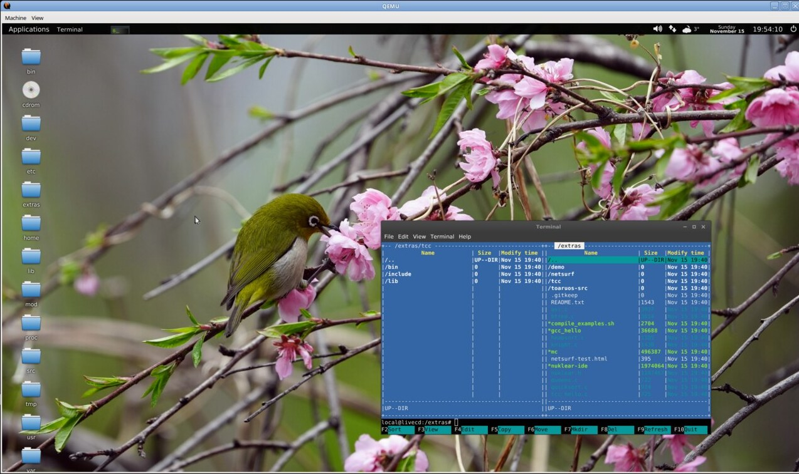

# tiny — ToaruOS + TinyCC + mini-commander

Everything here is built for [ToaruOS](https://github.com/klange/toaruos); the
individual projects keep their own upstreams:

- **[TinyCC](https://repo.or.cz/tinycc.git)** — a C compiler running *inside*
  ToaruOS.
- **[mini-commander](https://github.com/Tomas-M/mini-commander)** — a two-panel
  file manager with viewer and editor, built on top of a custom ncurses shim
  for ToaruOS.
- **[NetSurf](https://www.netsurf-browser.org/)** — a static browser for local
  files and plain HTTP pages, built with the
  [ToaruOS frontend](https://github.com/toaruos/netsurf-frontend-toaru).
- **[Nuklear IDE](nuklear-ide/)** — a small immediate-mode GUI IDE built on
  [Nuklear](https://github.com/Immediate-Mode-UI/Nuklear) for Linux and
  ToaruOS.
- **[Tiny IDE](tiny-ide/)** — a small ncurses IDE for Linux with the same
  project-tree/editor/build core and a mini-commander-style interface, ported
  to ToaruOS over the shared curses shim.

One command downloads, builds and runs **ToaruOS 2.3.2** in QEMU with all of
the above.

```bash
./tests/build-toaru.sh
```

A lighter variant exists: `./tests/run-toaru.sh` downloads the official
ToaruOS 2.3.2 ISO and repacks only its ramdisk — the payload (tcc, mc,
examples, sources) travels inside `ramdisk.igz` under `/extras`. No ToaruOS
build, no Nuklear IDE, no NetSurf.

The first run downloads the ISO, the ToaruOS sources and TinyCC and builds
everything (a few minutes); later runs only fill in what is missing. A QEMU
window with ToaruOS then opens (see "Inside ToaruOS" below if you start the VM
by hand). The serial line is logged in as `root@livecd`; the graphical session
as `local` (password `local`).

Nothing under `_build/` or `_import/` is irreplaceable: they can be
deleted at any time and `build-toaru.sh` will download and build everything
again.  `_import/` holds the downloads (ISO, source clones, tarballs), so
deleting only `_build/` does not force anything to be downloaded again.

---

## What the script does

`tests/build-toaru.sh` performs these steps (only when needed — anything already
built in `_build/` is not downloaded or rebuilt):

1. downloads `image.iso` (ToaruOS 2.3.2) into `_import/download/`,
2. clones the ToaruOS sources (tag `v2.3.2`) into `_import/download/toaruos-src`,
3. runs `mktcc.sh`, which clones TinyCC into `_import/download/tinycc` and
   builds (directly in the clone `_import/download/tinycc`) two things:
   - **the host cross compiler**
     `_build/tcc-toaru/bin/x86_64-toaru-tcc` + sysroot `_build/tcc-toaru/lib`
     (`libc.a`, `crt0.o`, `crti.o`, `crtn.o`, `libtcc1.a`, `include/`),
   - **tcc that runs inside ToaruOS**
     `_build/tcc-toaru/tcc-guest` (ToaruOS ELF, `CONFIG_TCCDIR=/extras/tcc`),
   - verification programs `_build/tcc-toaru/hello` and `.../test`,
4. clones mini-commander into `_import/mini-commander`, builds the copy in
   `_build/minicmd/mini-commander` with the cross compiler → `_build/output/mc`
   (`mc-toaru/build.sh mc`),
5. fetches the Nuklear headers into `_import/nuklear-ide/` (pinned commit;
   used by the IDE build and for browsing in the guest),
6. builds the native Nuklear IDE for ToaruOS (`_build/output/nuklear-ide-toaru`)
   and packs the ramdisk payload into an ISO: `/extras/nuklear-ide`, `/mc`,
   `/extras/tcc_test`, `/extras/tcc/{bin/tcc,include,lib}`, the sources from
   `tests/examples/*.c` (under `/extras/examples`), `/extras/gcc_hello`
   (built on the host by `gcc-toaru.sh`, when gcc is present),
   `/extras/nuklear.h`, `/extras/compile_examples.sh`, `/extras/README.txt`,
7. boots a **headless verification VM** and checks that `/extras/tcc_test`
   runs, that tcc inside ToaruOS compiles and runs
   `/extras/examples/tcc_hello.c` and
   every example, that `/extras/gcc_hello` from the host gcc runs, and that
   mini-commander draws its panels (with the current
   item highlighted), runs its command line on Enter, keeps the output on the
   normal screen until F9 returns to the panels, opens the viewer (F3) and
   editor (F4) and quits with F10 or a mouse click,
8. starts the **visible ToaruOS** in a QEMU window and leaves the VM running:
   - graphical boot: closes the first-boot tutorial, double-clicks the Terminal
     icon (QMP absolute pointer) and types the first commands with QEMU's
     `sendkey` (the session runs as user `local`, so the first command asks for
     its password, `local`),
   - headless boot: uses the root getty on the serial line.

The verification VM (step 7) can be skipped with `DEMO=0`, the QEMU window with
`VISIBLE=0`.

## Inside ToaruOS

All payload files live under `/extras` **inside the ramdisk** — no disk needs to
be mounted and `/` stays clean for the desktop icons (`mc` is also installed as
`/bin/mc`).

TinyCC:

```sh
tcc -o /tmp/hello /extras/examples/tcc_hello.c ; /tmp/hello
/extras/compile_examples.sh        # compiles and runs every *.c in /extras
```

`tcc` has the sysroot built in (`/extras/tcc`), so no `-B` or `-I` is needed.
Write outputs to `/tmp` — the ramdisk is read-only unless the kernel migrates
it to a writable tmpfs (`migrate`, the default).

mini-commander:

```sh
mc /extras        (also /bin/mc)
```

Quit with **F10** (same as Midnight Commander); the usual mouse and keyboard
bindings apply (`Tab` switches panels, `F3` viewer, `F4` editor, …).

Commands run from the command line are executed on the normal terminal screen
and their output stays visible until you press **F9** to return to the panels.
Because this is the normal screen (not the ncurses alternate screen), the
graphical Terminal's scrollback can be used to review long output:
**Shift+PgUp/Shift+PgDn** or the mouse wheel.

## Building a program with the host gcc

TinyCC is not the only option: the x86_64 SysV ABI is the same as on Linux, so
a program for ToaruOS can be compiled by the **host gcc**. What differs is the
C library, the startup code and the ELF layout — and all three are in the
sysroot that `mktcc.sh` builds (`_build/tcc-toaru/lib`).

```sh
./scripts/gcc-toaru.sh -o user/hello tests/gcc/hello.c   # gcc + GNU ld + toaru-elfpad.py
./tests/build-toaru.sh                             # packs user/ into /extras
# inside the guest:
/extras/hello
```

The same steps by hand:

```sh
gcc -ffreestanding -nostdinc -I_build/tcc-toaru/lib/include \
    -fno-pie -fno-pic -fno-stack-protector -mno-red-zone -O2 -c hello.c -o hello.o
ld -m elf_x86_64 -static -Ttext-segment=0x3F000000 -o hello \
    _build/tcc-toaru/lib/crt0.o _build/tcc-toaru/lib/crti.o hello.o \
    _build/tcc-toaru/lib/crtn.o -L_build/tcc-toaru/lib -lc
./scripts/toaru-elfpad.py hello                      # page-align the PT_LOAD segments
```

Notes:

- `-fno-pie` is required — the kernel's loader accepts only `ET_EXEC`
  (`kernel/misc/elf64.c`).
- `-nostdinc -I…/include` keeps glibc out; the ToaruOS headers come from the ISO.
- `-fno-stack-protector` — ToaruOS libc has no `__stack_chk_fail`. The red zone
  is not a problem: the kernel subtracts 128 bytes before a signal frame.
- Use **GNU ld**, not `ld.lld`: lld puts the ELF headers in a separate `PT_LOAD`
  at `0x200000` and the result crashes in the guest. `-Ttext-segment` makes GNU
  ld produce the layout tcc uses (`--image-base` does not help either — lld
  then emits segments that `toaru-elfpad.py` cannot align).
- `toaru-elfpad.py` is still needed — the last `PT_LOAD` usually ends a few
  bytes before a page boundary and the kernel maps a segment page by page from
  `p_vaddr`.

The control VM checks this route as well: `tests/build-toaru.sh` builds
`tests/gcc/hello.c` with the host gcc into `/extras/gcc_hello` and runs it.
TinyCC remains the compiler that runs *inside* ToaruOS.

## Nuklear IDE (Linux and ToaruOS)

`nuklear-ide/` is a small, self-contained IDE example built on Nuklear:
file tree, tabs, C/C++ syntax highlighting, asynchronous TinyCC compile/run,
clickable compiler errors, a dark/light theme and an output pane.

Linux uses GLFW + OpenGL 2.1:

```sh
cd nuklear-ide
make
make run            # builds/uses TinyCC, opens demo/hello.c; F5 compiles and runs
```

Requires GLFW 3 development headers and OpenGL (`glfw-devel` +
`mesa-libGL-devel` on Fedora) and a host TinyCC. `make tcc` uses `tcc` from
`PATH` or builds one from `_import/download/tinycc`; `TCC=/path/to/tcc`
overrides it. TinyCC is C-only, so C++ files use `CXX` for the actual build.

There is also a native **ToaruOS** build: a decorated, resizable Yutani window
(with the standard title bar and close button) and a software Nuklear
rasterizer, statically linked with ToaruOS libc and the Yutani client sources.
Nuklear has no terminal backend, so there is no text-mode variant.
`tests/build-toaru.sh` builds it and installs it as `/extras/nuklear-ide`; it
can also be built standalone with `make -C nuklear-ide toaru`. The in-guest
compiler is `/extras/tcc/bin/tcc`.

Nuklear's headers live in `_import/nuklear-ide/`; both IDE builds fetch them
on demand with `nuklear-ide/fetch-nuklear.sh`, which downloads them from a
pinned upstream commit. See
`nuklear-ide/README.md` for shortcuts, architecture and porting notes.

## Tiny IDE (Linux, ncurses)

`tiny-ide/` is the terminal counterpart of Nuklear IDE: project tree, tabs,
UTF-8 editing with C/C++ highlighting, undo/redo, asynchronous TinyCC build/run,
function-key footer, mouse support and compiler diagnostics that jump to the
reported line. See [tiny-ide/README.md](tiny-ide/README.md) for all shortcuts
and limitations.

```sh
make -C tiny-ide
make -C tiny-ide tcc          # system tcc or _build/host-tcc/tcc
make -C tiny-ide run          # demo; F5 builds and runs it
make -C tiny-ide check        # editor unit tests + pseudo-terminal integration
```

The Linux version is complete. For ToaruOS, `tiny-ide/build-toaru.sh` builds
a static binary with the cross TinyCC and the shared `mc-toaru` curses shim;
`tests/build-toaru.sh` installs it into the ramdisk as `/extras/tiny-ide`
(with the demo in `/extras/tiny-ide-demo`) and the headless check drives it:
F5 builds and runs the demo with the guest TinyCC, F10 quits.

## Controlling the VM

```bash
./scripts/toaru-vm.sh start            # starts the VM in the background (log _build/work/out.log)
./scripts/toaru-vm.sh send 'ls /'      # serial line (only in a headless boot, getty on ttyS1)
./scripts/toaru-vm.sh log 200          # last 200 log lines without ANSI sequences
./scripts/toaru-vm.sh status           # running? log size
./scripts/toaru-vm.sh mon 'info reg'   # QEMU monitor command (QMP socket)
./scripts/toaru-vm.sh qmp '{"execute":"query-status"}'   # raw QMP command (JSON)
./scripts/toaru-vm.sh stop             # stops QEMU
```

## Boot-time benchmark

`tests/bench-boot.sh` compares booting ToaruOS from the ISO (SeaBIOS El Torito
+ the ToaruOS bootloader) with QEMU's direct multiboot boot (`-kernel` /
`-initrd`).  Both modes get identical QEMU devices and the same kernel command
line, and both are timed from the QEMU launch to the serial getty prompt
(`root@livecd` on ttyS1).  The kernel and ramdisk are extracted from the ISO
unless `KERNEL`/`INITRD` are supplied, so both modes boot the same pair.

```bash
./tests/bench-boot.sh                    # 7 runs of the stock ISO
N=5 ISO=_build/netsurf.iso ./tests/bench-boot.sh
KERNEL=/tmp/kernel INITRD=/tmp/ramdisk.igz ./tests/bench-boot.sh
```

On the development machine (QEMU 9.2.2, KVM, 1 GiB RAM, 2 vCPUs) the medians
were 3.78 s vs 1.99 s for the stock 6.7 MB ramdisk, and 6.52 s vs 2.64 s for
the NetSurf ISO with its 17.6 MB ramdisk.  The difference is dominated by the
bootloader reading the compressed ramdisk from the emulated ATAPI CD through
BIOS calls (a few MB/s); QEMU's direct boot loads it from the host file
instead.  Note that direct boot needs `-append "root=/dev/ram0
start=--headless"` and the `gettyargs` fw_cfg entry, otherwise userspace will
not start the serial getty.  QEMU's multiboot loader provides no VBE
information (`multiboot knows VBE. we don't`); this does not prevent a
graphical boot on QEMU's stdvga, because ToaruOS's `vid=auto` modesets the
emulated Bochs/QEMU VGA itself.  On video hardware without such a kernel
driver the framebuffer has to come from the bootloader (VBE or UEFI GOP), so
there the ISO/bootloader path remains the right choice.

## Optional environment variables

| Variable | Meaning |
|---|---|
| `VISIBLE=0` | no QEMU window (serial line only); the automated check still runs |
| `HEADLESS=1` | headless boot even when the QEMU window is open (getty on the serial line) |
| `DEMO=0` | skip the verification VM (step 7) |
| `ACCEL=tcg` | no KVM (slower, but `-d int` logs exceptions under TCG) |
| `QEMU_EXTRA=...` | extra QEMU arguments (e.g. `-s` for the gdb stub) |

The same variables can be passed to `scripts/toaru-vm.sh start`.

## Directory layout

```
tiny/
├─ tests/build-toaru.sh      # one-click: download, build, run
├─ tests/bench-boot.sh     # ISO vs -kernel/-initrd boot timing
├─ tests/examples/*.c      # sample programs (copied to /extras/examples)
├─ tests/gcc/hello.c       # program built by the host gcc (into /extras)
├─ user/                   # YOUR files — copied into /extras
├─ scripts/                # all helper scripts of the project
│   ├─ build-toaruos.sh    # builds ToaruOS itself (container or host)
│   ├─ fetch-gcc-local.sh  # local cross-gcc archive for build-toaruos.sh
│   ├─ gcc-toaru.sh        # builds a program for ToaruOS with the HOST gcc
│   ├─ mklibc.sh           # libc.a, crt*.o and headers from the ISO (used by mktcc.sh)
│   ├─ mktcc.sh            # TinyCC: cross compiler and in-guest compiler
│   ├─ mkshare.sh          # ext2 image from _build/push (legacy /share flow)
│   ├─ toaru-vm.sh         # start/stop/send/log/status/mon
│   ├─ need.sh             # dependency check with package-install hints
│   ├─ guest-tcc.sh        # measure tcc inside the running guest
│   ├─ guest-tcc-repro.sh  # repro measurements for tcc/toaru/repro
│   ├─ toaru-elfpad.py     # ELF format check for the ToaruOS loader
│   └─ toaru-ksym.py       # kernel symbols without .symtab
├─ mc-toaru/
│   ├─ build.sh            # mc | probe | stage | clean (cross tcc)
│   ├─ patches/mc-toaru.patch   # the single carrier of the mini-commander port
│   ├─ mkiso.sh            # custom ISO with the payload inside ramdisk.igz
│   └─ toaru/              # ncurses shim, compat layer, missing headers
├─ nuklear-ide/            # small Nuklear IDE (Linux + native ToaruOS)
│   ├─ main.c              # UI, editor tabs, file tree, async build/run
│   ├─ toaru_backend.h     # Yutani window + software Nuklear rasterizer
│   ├─ toaru/build.sh      # static ToaruOS build (build-toaru installs it)
│   ├─ demo/hello.c        # F5 demo program
│   └─ fetch-nuklear.sh    # re-download the headers from upstream
├─ tiny-ide/               # ncurses IDE for Linux and ToaruOS
│   ├─ editor.c            # UTF-8 editor model and delta undo/redo
│   ├─ app.c / runner.c    # files/tree/tabs and async compiler/program
│   ├─ ui.c / dialogs.c    # mini-commander-style ncurses interface
│   ├─ toaru/ + build-toaru.sh   # guest compat layer and cross build
│   └─ tests/              # model tests and pseudo-terminal smoke tests
├─ toaruos-ext2-sparse-bug.md  # ext2 sparse-file bug report (upstream is archived)
├─ _import/                # downloads: ISO, sources, clones, tarballs (safe to delete)
│   ├─ download/           # image.iso, toaruos-src, tinycc, netsurf tarballs
│   ├─ mini-commander/     # unmodified mini-commander clone
│   └─ nuklear-ide/        # Nuklear headers fetched on demand
├─ _build/                 # build trees and artifacts (safe to delete)
│   ├─ toaruos-src/        # working copy of the sources (IDE/NetSurf patch it)
│   ├─ tcc-toaru/          # cross tcc, sysroot, tcc-guest, test programs
│   ├─ push/               # ramdisk payload before packing (goes to /extras)
│   ├─ ramdisk.tgz         # repacked ramdisk for the ISO-less boot
│   ├─ kernel.mb           # stock kernel with the multiboot VBE request cleared
│   └─ work/               # FIFO, logs and pid files of the running VM
│   └─ output/             # finished binaries: mc, nuklear-ide-toaru, src/ staging
├─ _tmp/                   # scratch binaries (safe to empty)
└─ README.md
```

`_import/` and `_build/` can be deleted at any time (the Nuklear
IDE headers in `_import/nuklear-ide/` come back with one run of
`nuklear-ide/fetch-nuklear.sh`); `user/` **cannot** — its
contents are copied into `/extras` on every run (and
override built-in files of the same name). Directories starting with an
underscore are treated as disposable, which is why user data belongs in
`user/`.

## Requirements

`bash`, `curl`, `git`, `patch`, `qemu-system-x86_64`, `python3`, `7z` (p7zip;
unpacks the ISO when building the sysroot), host `gcc` and GNU `ld`
(binutils — used to build the cross tcc and `gcc-toaru.sh`) and `e2fsprogs`
(`mke2fs`, `debugfs`) and `genisoimage` (`isoinfo`, for the custom ISO).
No `sudo` is needed.

Fedora: `dnf install qemu-system-x86 p7zip-plugins gcc e2fsprogs python3 curl git patch genisoimage mtools dosfstools`
Debian/Ubuntu: `apt install qemu-system-x86 p7zip-full gcc e2fsprogs python3 curl git patch genisoimage mtools dosfstools`

For automatic mounting in the **visible** QEMU window, `wmctrl` (X11) or
`xdotool` is used when available to bring the QEMU window to the front; the
pointer and the keystrokes are then injected through QMP, so the mount works
without them too. Without either tool the script only prints a warning.

## Cleaning and rebuilding

| Command | Effect |
|---|---|
| `rm -rf _build` | deletes downloads and images; the next run fetches and builds everything again |
| `./mc-toaru/build.sh mc` | rebuilds only mini-commander (after a change in `toaru/` or the patch) |
| `./mc-toaru/build.sh clean` | deletes `_build/output` |
| `rm -rf _tmp/*` | empties the scratch directory |

After changing `mc-toaru/toaru/*.c` you must run `./mc-toaru/build.sh mc` —
`build-toaru.sh` only builds `mc` when the binary is missing.

## Port notes (what had to be solved)

- **ELF for ToaruOS**: base `0x3F000000`, `ET_EXEC`, every `PT_LOAD` starting on
  a page boundary. The loader maps segments page by page from `p_vaddr`
  (`kernel/misc/elf64.c`), so an unaligned segment loses its last page and the
  kernel crashes. Checked by `toaru-elfpad.py`.
- **Heap**: starts at the aligned end of the last `PT_LOAD`; programs must not
  assume `brk` starts at zero.
- **ncurses shim** (`mc-toaru/toaru/curses.c`) implements only the subset of
  ncurses that mc uses and draws directly with ANSI sequences. Beware of SGR:
  every sequence must end with `m` — without it the terminal takes the next
  character as the sequence terminator and swallows it (this is exactly what
  made the first letter of every button label disappear, `F2 Sort` → `ort`).
- **Function keys**: ToaruOS sends F1–F4 as `ESC O P`…`ESC O S` and F5–F12 as
  `ESC [ n ~`. The shim's `decode_escape()` originally compared those bytes with
  an off-by-one offset, so every function key failed and its tail leaked as text
  (`F1` → `P`, `F9` → `20~`). The parser now keeps the bytes following ESC in
  one buffer and matches the whole sequence; `tests/build-toaru.sh` checks that
  F9/F10 do not leak and that F10 quits mc.
- **Mouse**: the shim enables SGR mouse reporting (`ESC[?1006`), but ToaruOS
  actually sends the reports as `ESC[<b;x;yM` / `…m`; those have to be parsed
  before the generic escape-sequence code, otherwise a click leaks into the
  terminal as text (`<0;8;4M<0;8;4m`). `decode_sgr_mouse()` / `decode_x10_mouse()`
  now queue a `MEVENT` and return `KEY_MOUSE`. The automated check clicks the
  F10 footer and verifies that mc returns to the shell.
- **Enter**: the Terminal sends Enter as CR (`\r`), while mc compares the key
  with `'\n'`. Real ncurses translates CR to NL in its default `nl()` mode; the
  shim now does the same (`wget_wch()`), otherwise Enter did nothing — neither
  on the command line nor in dialogs.
- **Colors and the current item**: `wattron()` used to be a no-op and cells
  written by `waddstr()` ignored the window's current attributes, so the panel
  was drawn in one color and the current item had no highlight. `wattron()` now
  stores the attributes (a color pair replaces the previous one, as in ncurses)
  and `cell_put()` applies them; the active row is black on cyan, `.c`/`.h`
  files cyan and executable files bold green. The automated check looks for the
  black-on-cyan SGR sequence in the guest output.
- **Command output, F9 and scrolling**: `endwin()` now really leaves the
  alternate screen (`?1049l`) and resets SGR (`ESC[0m`), so a command runs on
  the normal screen with the standard background instead of on top of the
  panels' blue attributes. mc keeps the output there and waits for **F9**
  before returning to the panels; the output stays in the terminal's
  scrollback, reachable with Shift+PgUp/Shift+PgDn or the mouse wheel. When
  re-entering curses mode, `init_screen()` enters the alternate screen before
  `refresh()`, otherwise it would paint the panels over the output.
- **ramdisk ownership**: `mkiso.sh` used to repack the ramdisk with
  `--owner=0`.  `/home/local` is mode 750 in the stock image, so the live
  session (uid 1000) could not `chdir` to `~/Desktop`; the desktop thus fell
  back to the current directory and showed `bin`, `cdrom`, `dev`, … as icons.
  The stock live image is owned by `local` (uid/gid 1000), so the repack now
  uses `--owner=1000 --group=1000`; the four original launchers (plus the
  CD-ROM created at boot) are back in the top-left corner.
- **ext2 and sparse files** — the trickiest thing in the project: `mke2fs -d`
  writes files with holes (zero blocks are not allocated), but `modules/ext2.c`
  in ToaruOS 2.3.2 has two bugs:
  `inode_read_block()` compares the block index against `i_blocks` (the number
  of *allocated* sectors), so blocks past the allocated region read as zeros
  even when they are physically allocated and contain data; and for a hole
  `read_block(0)` returns `E_BADBLOCK` without touching the buffer — while
  `read_ext2()` reuses one buffer, so a hole returns **the contents of the
  previous block**. Result: `mc` was loaded corrupted (`active_panel` in
  `.data` became NULL) and crashed with SIGSEGV in `printf("%s")`.
  `mkshare.sh` therefore runs `debugfs fallocate` after `mke2fs`, physically
  allocating every block of every file, and verifies the result at the end.
  Without `debugfs` the script refuses to continue. Details, a verified
  reproduction and a proposed patch are in `toaruos-ext2-sparse-bug.md`.
- **Known ToaruOS 2.3.2 libc bugs** (found while porting): `fflush(NULL)` crashes with SIGSEGV,
  `printf("%-7s")` truncates, `dprintf` is missing, `.fini_array` is not
  called, `%f` has no default precision, `sscanf("%hd")` is broken,
  `dlsym(RTLD_DEFAULT, …)` crashes and `mmap` is not implemented at all
  (`sys/mman.h` is an empty placeholder). The shim and mc avoid all of these;
  `view_edit.c` reads files with `read()` instead of `mmap()`, otherwise taking
  F3/F4 crashed with SIGSEGV because the old stub returned NULL.
- **Examples**: all `tests/examples/*.c` files are plain C (C99/C11) and
  TinyCC compiles and runs them. `queens.c`, `knight.c` and `towers.c` are the
  chess/toy examples; the rest are data structures and sorting.
  `/extras/compile_examples.sh` compiles every `*.c` in `/extras`.

## License

tiny is licensed under the **GNU General Public License v3.0** — see `LICENSE`.
Third-party components keep their own licenses (see `NOTICE`):

- mini-commander — GPLv3,
- TinyCC — LGPL-2.1,
- ToaruOS — BSD-2-Clause,
- Nuklear — public domain / MIT.

---


